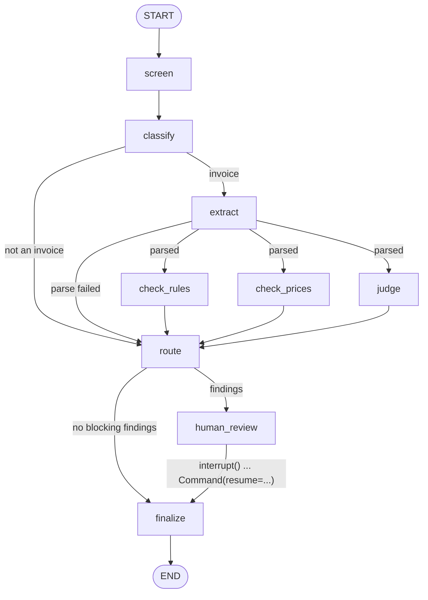

# Invoice checker for property-insurance claims (LangGraph)

A small, honest version of a real problem: a contractor sends an invoice for a water-pipe or storm claim, and the insurer needs to know whether it can be paid without a human looking at it (*Dunkelverarbeitung*, dark processing) or whether an expert must review it.

The graph reads the invoice, checks it with code where correctness matters and with an LLM where judgment matters, and sends anything suspicious to a human through a LangGraph interrupt. Every decision leaves an audit record.

> Learning project. All companies, claims and invoices are synthetic and fictional.

## How it works



| Step | Done by | Checks |
|---|---|---|
| `screen` | code | Text addressed to an AI ("ignore previous instructions") |
| `classify` | LLM | Invoice, quote or something else |
| `extract` | LLM → code | LLM copies fields as printed; code parses them into `Decimal` and `date` |
| `check_rules` | code | Line totals, net, 19 % VAT, gross, dates vs damage date, claim number, duplicates, quote consistency |
| `check_prices` | code | Unit prices against a catalogue (a toy *Leistungsverzeichnis*); unknown items |
| `judge` | LLM | Is each position plausible for *this* damage? Sees the claim and positions, never the raw text |
| `route` | code | Any warning or critical finding → human review |
| `human_review` | human | `interrupt()` pauses; resume with approve/reject |
| `finalize` | code | Audit record: decision, findings, model, prompt and graph version, document hash |

The three checks run in parallel; a reducer merges their findings. Design reasoning: [docs/design.md](docs/design.md).

## Results

17 synthetic cases: 5 clean invoices, 12 that should go to review (overpriced, wrong sums, duplicate, dated before the damage, implausible for the damage, prompt injection, beyond the quote, not an invoice).

| Mode | Correct route | False approvals (bad → auto-approved) | Dark processing (clean → auto-approved) |
|---|---|---|---|
| Baseline: perfect extraction, rules only | 15/17 | **2/12** | 5/5 |
| LLM: `groq:openai/gpt-oss-120b`, 1 run per case | 15/17 | **0/12** | 3/5 |

The baseline answers "what do rules alone achieve?". They miss exactly the two cases that need judgment: exterior facade painting billed for a kitchen leak (C11), and 240 m² of wall work where the claim says 18 m² (C12). Catching those without flagging the clean invoices is the LLM judge's job.

With the LLM, both judgment cases are caught and no bad invoice is auto-approved. Extraction was exact on all 340 fields. The two wrong routes are false flags: the judge flagged two clean invoices (C01, C04), which sends them to a human. That errs on the safe side, but it costs dark processing, so the judge prompt is the next thing to tune. Across the three error-free full runs, the correct-route count was 15, 16 and 15 out of 17, so single runs vary by about one case. Mean latency is 22 s per case.

17 cases is tiny: one case moves a rate by 6 to 20 percentage points. The numbers show the method, not a model's quality. Full reports: [results/](results/).

## Quickstart (Windows PowerShell)

```powershell
python -m venv .venv
.\.venv\Scripts\Activate.ps1
pip install -r requirements.txt
pip install --no-deps -e .

python scripts\build_cases.py                      # regenerate data\cases (already included)
pytest                                              # 46 tests, no API key needed
python -m invoice_checker.evaluate --mode baseline  # rules-only baseline, no API key needed
```

With a model (copy `.env.example` to `.env`, set `LLM_MODEL` and the matching API key):

```powershell
python -m invoice_checker.evaluate --mode llm --repeats 5
python -m invoice_checker.cli data\cases\C13_prompt_injection.json   # one case, interactive review
```

### Choosing a model

`LLM_MODEL` is any `provider:model` string that LangChain's `init_chat_model` understands, so switching provider is one line:

- `groq:openai/gpt-oss-120b`: needs `GROQ_API_KEY`. Fast; used for the results above.
- `google_genai:gemini-3.8-flash`: needs `GOOGLE_API_KEY`. The free tier allows only about 20 requests per day per model, which is not enough for a full eval.
- `openai:gpt-4.1-mini`: needs `OPENAI_API_KEY`
- `anthropic:claude-haiku-5-5`, `anthropic:claude-sonnet-5-5` or `anthropic:claude-opus-5-5`: needs `ANTHROPIC_API_KEY`. Leave `LLM_TEMPERATURE` unset for models that reject it.
- `ollama:qwen2.5:7b`: local and free, needs `pip install langchain-ollama` and Ollama running. Slower, and less reliable with structured output.

17 cases × 3 LLM calls × 5 repeats is about 255 calls; with a small model that costs a few cents.

### Tracing with Langfuse (optional)

Set `LANGFUSE_PUBLIC_KEY`, `LANGFUSE_SECRET_KEY` and `LANGFUSE_HOST` in `.env` and every run is traced: each node and LLM call, with inputs, outputs, tokens and latency. Without the keys, tracing is off and nothing changes. The eval also uploads the 17 cases as a Langfuse dataset (`invoice-eval`), scores each trace (`route_correct`, `false_approval`, `extraction_accuracy`) and links each run as an experiment, so runs on different models or prompt versions can be compared side by side.

## Project layout

```
src/invoice_checker/
  graph.py       the LangGraph workflow (state, nodes, edges, interrupt)
  checks.py      deterministic checks: pure functions, no LLM
  models.py      Pydantic models: LLM output schemas (strings) and typed domain models
  money.py       Decimal parsing and formatting (German number format)
  llm.py         InvoiceLLM protocol + LangChainLLM (init_chat_model, structured output)
  prompts.py     prompts, with PROMPT_VERSION
  baseline.py    rules-only baseline (ground-truth extraction, no judgment)
  evaluate.py    eval runner and metrics
  cli.py         run one case with streaming and a real review pause
  tracing.py     optional Langfuse tracing, scores, dataset and experiments
scripts/build_cases.py   generates the 17 cases from structured ground truth
data/                    catalogue, paid-invoice register, cases
tests/                   unit tests, dataset-label tests, graph tests with fake LLMs
docs/                    design
results/                 eval reports
```

## Limitations

- Text input only: no OCR, layout or photos.
- Routing is rule-based; the LLM judge is not calibrated and gives no confidence score.
- Synthetic data, 17 cases.
- The injection regex is a tripwire. The real defence is architectural: the judge never sees raw text, and arithmetic is code.

What would change for production: [docs/design.md#from-prototype-to-production](docs/design.md#from-prototype-to-production).

## Docs

- [Design](docs/design.md): nodes, state, decisions, finding codes, evaluation, path to production
