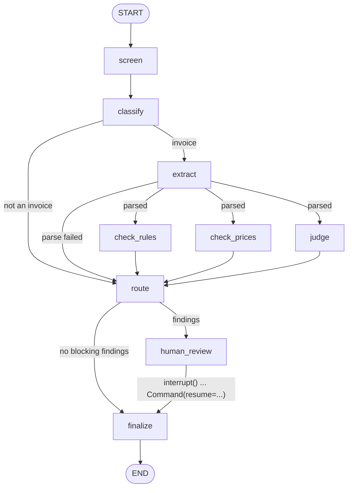

# Design

## Architecture

```
┌─────────────────────────── ENTRY POINTS (how you start it) ────────────────────────────┐
│  cli.py                                     evaluate.py                                 │
│  checks ONE invoice, asks the expert        runs ALL 17 cases, writes metrics           │
│  approve/reject in the terminal             (--mode llm | baseline, --repeats N)         │
└───────────────┬─────────────────────────────────────────┬───────────────────────────────┘
                │ loads                                    │ loads
                ▼                                          ▼
┌────────────────────────── DATA (inputs) ───────────────────────────────────────────────┐
│ cases.py  → data/cases/C01…C17.json   (claim + invoice text + expected answer)          │
│ catalogue.py → data/price_catalogue.csv (prices) · data/paid_invoices.csv (paid list)  │
└────────────────────────────────────────┬────────────────────────────────────────────────┘
                                         ▼
┌─────────────────────── WORKFLOW ENGINE: graph.py (LangGraph) ──────────────────────────┐
│  build_graph(llm, catalogue, paid_register, checkpointer)                               │
│  StateGraph over CheckState · 9 nodes · InMemorySaver checkpointer (pause/resume)       │
└─────────┬───────────────────────────────┬──────────────────────────────┬────────────────┘
          │ "code computes"               │ "LLM copies & judges"        │ pauses for human
          ▼                               ▼                              ▼
┌──────────────────────┐  ┌──────────────────────────────────┐  ┌─────────────────────────┐
│ checks.py            │  │ llm.py                           │  │ interrupt() → expert     │
│ arithmetic, VAT,     │  │ InvoiceLLM (interface)           │  │ Command(resume=...)      │
│ dates, duplicates,   │  │  ├─ LangChainLLM  (real model)   │  └─────────────────────────┘
│ prices, quote,       │  │  └─ OracleLLM (baseline.py,      │
│ injection regex      │  │       fake, no API key)          │
│      │               │  │ prompts.py (the 3 prompts)       │
│      ▼               │  └──────────────┬───────────────────┘
│ money.py             │                 ▼  LLM_MODEL="provider:model"
│ parse € / dates      │      ┌────────────────────────────────────────┐
│ (Decimal, no float)  │      │ Groq · Google · OpenAI · Anthropic ·   │
└──────────────────────┘      │ Ollama  (via LangChain init_chat_model)│
          ▲                   └────────────────────────────────────────┘
          │ all modules share the data shapes in
┌─────────┴──────────────────────────────────────────────────────────────────────────────┐
│ models.py  (Pydantic classes; to_document() = the bridge from LLM strings to numbers)  │
└────────────────────────────────────────────────────────────────────────────────────────┘
                                         ▼
┌─────────────────────────── OUTPUTS ────────────────────────────────────────────────────┐
│ runs/<case>-<id>.json  = audit record per invoice (from cli.py)                         │
│ results/eval_<mode>_<time>.md/.json = eval report (from evaluate.py)                    │
└────────────────────────────────────────────────────────────────────────────────────────┘
```

The graph runs a fixed path, plain code does everything that must be exactly right, the LLM only classifies, extracts and judges, and any doubt ends with a human.

## The graph



## Nodes

| Node | Code or LLM | What it does | Why this way |
|---|---|---|---|
| `screen` | Code | Regex tripwire for text addressed to an AI ("Ignoriere alle vorherigen Anweisungen") | Cheap, runs before any LLM sees the text |
| `classify` | LLM | Invoice, quote or other; trade | Non-invoices skip extraction and go to a human |
| `extract` | LLM | Copies every field as printed (strings) into a Pydantic schema; code converts to `Decimal` and `date` | The LLM copies, the code computes |
| `check_rules` | Code | Line totals, net, 19 % VAT, gross, dates vs damage date, claim number, duplicates, quote consistency | Correctness must not depend on a model |
| `check_prices` | Code (lookup) | Unit price vs catalogue maximum; unknown items; unit mismatch | A lookup is deterministic, so it is a node, not a tool the LLM may forget to call |
| `judge` | LLM | For each position: plausible, questionable or implausible for this damage, with a reason | The one step that needs judgment |
| `route` | Code | Any `warning` or `critical` finding → human review | Simple, explainable, auditable |
| `human_review` | Human | `interrupt()` pauses; an expert approves or rejects; `Command(resume=...)` continues | Human review is a designed state, not an exception |
| `finalize` | Code | Writes the audit record | Every decision is traceable |

`check_rules`, `check_prices` and `judge` run **in parallel** (fan-out from `extract`); `route` waits for all three (fan-in).

## State

`CheckState` is a `TypedDict`. Everything in it is plain JSON (amounts as strings), so any checkpointer (in-memory, SQLite, Postgres) can store it. `findings` has a reducer:

```python
findings: Annotated[list[dict], operator.add]
```

Without it, the three parallel nodes would overwrite each other's findings; with it, LangGraph concatenates their updates.

## Classes

The project has 15 classes. Everything else (`checks.py`, `money.py`, `prompts.py`, `cases.py`) is plain functions.

| Class | File | What it is |
|---|---|---|
| `Claim` | `models.py` | The insurance claim: claim number, insurer, damage type, damage date, location, description |
| `LineItem` | `models.py` | One invoice line with real numbers (`Decimal`): quantity, unit, unit price, line total |
| `Document` | `models.py` | A parsed invoice or quote: number, date, contractor, line items, net, VAT, gross |
| `Finding` | `models.py` | One reason an invoice may need an expert: code, severity (info/warning/critical), message, source (rule/tool/llm) |
| `Classification` | `models.py` | Output of `classify`: doc type (invoice/quote/other) and trade |
| `ExtractedLineItem` | `models.py` | One line as strings, exactly as printed |
| `ExtractedDocument` | `models.py` | Output of `extract`: the whole document as strings; `to_document()` turns it into a `Document` |
| `ItemJudgment` | `models.py` | One judge verdict per line: plausible / questionable / implausible, with a reason |
| `JudgeResult` | `models.py` | Output of `judge`: the list of `ItemJudgment`s |
| `InvoiceLLM` | `llm.py` | Interface (Protocol): anything with `classify`, `extract` and `judge` can be plugged into the graph |
| `LangChainLLM` | `llm.py` | The real implementation: calls the provider chosen by `LLM_MODEL` and forces answers into the Pydantic schemas |
| `OracleLLM` | `baseline.py` | Fake LLM that returns the ground truth from the case files and judges everything plausible; measures what rules alone achieve, no API key needed |
| `CatalogueItem` | `catalogue.py` | One price-list row: code, trade, unit, typical price, max price |
| `PaidRegister` | `catalogue.py` | Already-paid invoices; `contains(contractor, number)` detects duplicates |
| `CheckState` | `graph.py` | The state shared by all nodes: inputs, extracted invoice, findings, route, decision, audit |

## Design decisions

1. **Workflow first, agent second.** The path through an invoice check is known, so it is a fixed graph. The LLM gets freedom only where judgment is needed. A ReAct agent choosing its own tools would be harder to test and to audit, with no benefit here.
2. **The LLM copies, the code computes.** The extraction schema has only strings, "exactly as printed". The prompt says never to correct a wrong total. Code parses into `Decimal` (never `float`) and does all arithmetic. If extraction misreads a number, the arithmetic check fails and the invoice goes to a human, so extraction errors fail safe.
3. **The judge never sees the raw document text.** It gets the claim description and the extracted positions only. Instructions hidden in the document (case C13) cannot reach it. A test checks this.
4. **Fail safe everywhere.** Every failure ends in human review, never in approval:

   | Failure | Result |
   |---|---|
   | Model output doesn't parse (classify) | `CLASSIFICATION_FAILED` → human |
   | Extraction doesn't parse to numbers and dates | `EXTRACTION_FAILED` → human |
   | Judge output doesn't parse | `JUDGE_FAILED` → human |
   | Judge skips positions or cites ones that don't exist | `JUDGE_INCOMPLETE` → human |
   | Document is not an invoice | `WRONG_DOC_TYPE` → human |

5. **Catch a judge that is pretending.** A fluent answer that skips positions or cites non-existent ones is not doing the task. `judge_findings` checks that the cited positions match the real ones exactly.
6. **Human review is resumable.** `interrupt()` saves the run in the checkpointer under its `thread_id` (one per invoice). On resume, the `human_review` node runs again from the top and `interrupt()` returns the expert's answer, so the node has no side effects before the interrupt.
7. **An audit record per decision**: decision, route, findings, judgments, reviewer note, model name, `PROMPT_VERSION`, `GRAPH_VERSION`, SHA-256 of the document, timestamp.
8. **The graph depends on a protocol, not a provider.** `build_graph(llm: InvoiceLLM, ...)`. Tests plug in fakes; the rules-only baseline plugs in an oracle; production plugs in `LangChainLLM`, which uses `init_chat_model("provider:model")`, so OpenAI, Anthropic or a local Ollama model is a one-line change.

## Finding codes

| Code | Severity | Source | Meaning |
|---|---|---|---|
| `PROMPT_INJECTION_SUSPECTED` | critical | rule | Text addressed to an automated checker |
| `WRONG_DOC_TYPE` | critical | llm | Not an invoice |
| `CLASSIFICATION_FAILED`, `EXTRACTION_FAILED` | critical | llm | Model output unusable |
| `QUOTE_EXTRACTION_FAILED` | warning | llm | The attached quote can't be parsed; the invoice is still checked, quote checks are skipped |
| `ARITH_LINE_TOTAL`, `ARITH_NET_TOTAL`, `ARITH_VAT`, `ARITH_GROSS_TOTAL` | critical | rule | Numbers don't add up (1 cent tolerance) |
| `VAT_RATE_UNUSUAL` | warning | rule | Not 19 % |
| `DATE_BEFORE_DAMAGE` | critical | rule | Invoice dated before the damage |
| `DATE_IN_FUTURE` | warning | rule | Invoice dated after today |
| `CLAIM_NUMBER_MISMATCH` | warning | rule | Refers to another claim |
| `DUPLICATE_INVOICE` | critical | tool | Already in the paid register |
| `DUPLICATE_LINE` | warning | rule | Same position billed twice |
| `PRICE_ABOVE_MAX` | warning | tool | Unit price above the catalogue maximum |
| `UNKNOWN_ITEM`, `UNIT_MISMATCH` | warning | tool | Not in the catalogue / billed in another unit |
| `EXCEEDS_QUOTE`, `QTY_ABOVE_QUOTE`, `PRICE_ABOVE_QUOTE`, `NOT_IN_QUOTE` | warning | rule | Invoice goes beyond the quote (10 % margin) |
| `JUDGE_FLAGGED` | warning | llm | Position questionable or implausible for this damage |
| `JUDGE_INCOMPLETE`, `JUDGE_FAILED` | warning | llm | Judge output can't be trusted |
| `PRICE_ABOVE_TYPICAL`, `CLAIM_NUMBER_MISSING` | info | tool/rule | Shown, but does not block |

## Prompt injection: defence in depth

1. **Architecture (the real defence):** the judge never sees raw text; arithmetic and prices are code, which cannot be talked round.
2. **Prompts:** document text is wrapped in `<document>` tags and declared untrusted data.
3. **Tripwire:** a regex in `screen` flags obvious attempts and sends them to a human. It is easy to evade and is not relied on alone.

## Evaluation design

- **17 synthetic cases** (`data/cases/`), generated from structured ground truth by `scripts/build_cases.py`, so the numbers are exact by construction: 5 clean, 12 that should go to review (price, arithmetic, duplicate, date, judgment, prompt injection, quote, wrong document type).
- **The labels are tested.** `tests/test_dataset.py` runs the rules on the ground truth and checks they produce exactly the expected findings. A wrong label fails the test suite.
- **Baseline first.** `--mode baseline` uses perfect extraction and no LLM judgment. It shows what rules alone achieve, and which cases need the LLM.
- **Metrics that match the business:**
  - *False approvals*: bad invoices auto-approved. This costs money and trust.
  - *Dark-processing rate*: clean invoices auto-approved. This saves expert time.
  - The costs are asymmetric: a false flag costs a few expert minutes, a false approval costs money. The target is: keep false approvals at a fixed low rate, then raise dark processing.
  - Plus: expected findings detected, extraction field accuracy, and consistency across repeated runs (`--repeats 5`).
- **Honest about n.** With 17 cases, one case moves a rate by 6 to 20 percentage points. The numbers show the method, not the model's quality.

## From prototype to production

| Here | In production |
|---|---|
| `InMemorySaver` | Postgres checkpointer; resume survives restarts |
| One process, `invoke` | Queue (Service Bus / Kafka) + async workers, autoscaling on queue depth |
| `print` | Tracing (LangSmith / Langfuse), latency and cost per document, override-rate dashboards |
| Rule-based routing | Calibrated scores; thresholds per trade and insurer; audit sampling of auto-approved documents |
| 17 synthetic cases | Golden set from historical expert decisions, stratified by trade, insurer, scan quality; CI gate on every prompt, model or graph change |
| Text input | OCR + layout model (the LDM), photos |
| Version constants | Prompts, models, datasets and graph versioned and logged in every audit record (already done here) |

## Limitations and next steps

- The judge's verdicts are not calibrated; there is no confidence score. Next: self-consistency (run the judge k times) or log-probabilities, then conformal thresholds.
- Contractor matching for duplicates uses names; real systems use tax ID or IBAN.
- `parse_amount` reads `1.234` (dot only) as 1.234; fine for German invoices, which always print cents.
- The injection regex is a tripwire, not a defence.
- Per-position fan-out with `Send` would let the judge check long invoices in parallel.
